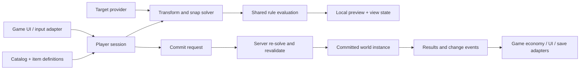

# Modular placement system plan

Draft 1 · 2026-11-01 · Planning only; no runtime implementation or project integration is complete.

Build a reusable C++ placement system in **UnrealExtendedGameplay → Systems → Placement**, using STG Studio's Advanced Placement System as a behavior reference. Players select an object, position a preview, rotate or snap it, confirm placement, and later reposition or remove it. Projects supply their own catalog, UI, input mappings, permissions, economy and save backend.

All new names and API shapes below are proposed. Confirm exact engine signatures during implementation and follow [framework architecture](../../ARCHITECTURE.md).

## 1. Starting point and intended changes

The installed reference is [Advanced Placement System](https://www.fab.com/listings/6cb15549-61b3-43f9-834f-bb5a720e0b37), under `/Game/Assets/Gameplay/STGStudio/AdvancedPlacementSystem/AdvancedPlacement`.

Read-only inspection of this copy confirmed:

- `AC_AdvancedPlacement`: catalog UI, camera tracing, preview and placement spawning, surface checks, rotation, grabbing, cancellation, deletion and server/multicast events.
- `BP_PlacementActor` and its shadow-object subclass: placed/preview state, overlap checks and parent/child snapping relationships.
- `DT_PlacementObjects`: 16 demo entries. Each can select a mesh or actor and describes display information, category, permitted surface, offsets and overlap-box dimensions.
- Surface validation uses hit information, surface categories and component tags. The component exposes editable input keys. These are observations of the installed assets, not a completed gameplay or multiplayer test.

| Reference behavior | Framework implementation |
| --- | --- |
| One component coordinates gameplay, UI and controls | Session orchestration with separate targeting, solving, validation, preview and commit responsibilities |
| Demo DataTable is the catalog | Native item definitions and a replaceable catalog source; optional DataTable conversion |
| Shadow actor derives from placement actor | Cosmetic preview with no gameplay side effects; arbitrary gameplay actors are never spawned just to preview them |
| Surface enum and per-object overlap box | Composable surface/support/clearance rules with explicit collision shapes and actionable failure reasons |
| Snapping and grabbed-parent relationships | Explicit anchors, stable instance IDs, cycle prevention and a documented dependent-object policy |
| Blueprint RPC events | Server-authoritative commands with shared validation, reservations and duplicate-request handling |
| Pack-specific UI and keys | Renderer-independent view state and semantic actions; Enhanced Input is an adapter |

Use the pack to compare observable behavior. Author native implementation and framework fixtures separately; the reusable feature must load and cook without STG demo assets, Starter Content, Folio, or Grandfather's Quarry classes.

## 2. Scope and defaults

**First complete release:** new placement, repositioning, cancellation, removal, static meshes and Blueprint actors, floor/wall/ceiling/slope restrictions, overlap clearance, configurable rotation, grid and anchor snapping, searchable categorized catalog data, pre-placed objects, multiplayer authority, and versioned persistence records.

Defaults:

- One active editing session per player controller; works with different pawn classes and split-screen.
- Component-based participation for existing actors; an optional convenience actor handles simple mesh items.
- Free surface placement, optional grid/rotation steps, and authored anchors. No grid is forced on every item.
- Placed objects keep their committed transform while another transform is previewed. Repositioning is an explicit transaction.
- Moving an object with snapped dependents is **blocked by default**. An opt-in policy can move a validated group; there is no implicit recursive dragging.
- Uniform, positive scale only in the first release. Interactive scaling, deforming geometry, physical grab simulation, wall construction, terrain editing and structural destruction are later extensions.
- No mandatory UMG/Folio screen, inventory, currency, GAS ability, online provider, or save plugin.
- No cross-streaming-level snap relationships in the first release. The owning level/domain is part of every instance record.

## 3. Ownership and folder structure

Implement inside the existing `UnrealExtendedGameplay` runtime module, rather than adding a new plugin for each policy. Keep feature includes under `UnrealExtendedGameplay/Systems/Placement/`. The current module uses feature folders; put internal implementation under `Private/` within this feature and do not reorganize unrelated existing systems. Follow the repository's public/private dependency rules for new types.

```text
UnrealExtendedGameplay/
  Source/UnrealExtendedGameplay/Systems/Placement/
    Core/          shared types, transform math, solver, validation results
    Data/          item definitions, profiles, catalog contract and asset catalog
    Player/        session component, input configuration and input adapter
    World/         placeable component, convenience actor, world registry
    Targeting/     target-provider contract and camera-ray implementation
    Rules/         validation-rule base and built-in rules
    Snapping/      anchor component, compatibility and candidate selection
    Preview/       preview contract and default mesh renderer
    Integration/   existing interaction-system adapter
    Private/       internal implementation and Tests/
  Source/UnrealExtendedGameplayEditor/Placement/
                   data validation, authoring helpers, optional reference-table converter
  Docs/Placement.md                 eventual user guide
  Docs/PlacementTesting.md          eventual native verification procedure
  Docs/PlacementPlan.md             this plan
```

| Proposed owner | Responsibility |
| --- | --- |
| `UEGPlacementSessionComponent` | Player-owned session state, commands, asset-load lifetime, preview updates and operation results; attached to the player controller |
| `UEGPlaceableComponent` | Stable instance ID, definition ID, committed state, revision and snap relationship; adds placement support to an existing actor |
| `AEGPlacedMeshActor` | Optional simple actor containing mesh and placeable components; no required player or game subclass |
| `UEGPlacementWorldSubsystem` | Per-world authoritative registry, reservations, snap occupancy and command execution; no networking owned by the subsystem itself |
| `UEGPlacementItemDefinition` | `UPrimaryDataAsset` describing one catalog item and its soft content references |
| `UEGPlacementProfile` | Shared targeting distance, collision, rotation, snapping and ordered rule configuration |
| Target, catalog and preview contracts | Replaceable sources/renderers owned by the session or project; native defaults plus Blueprint extension points |
| `UEGPlacementRule` | Instanced, stateless rule configuration. Reads an immutable evaluation context; never mutates the world or charges a cost |
| `UEGPlacementAnchorComponent` | Stable anchor names, local transforms, compatibility tags and capacity |

These are responsibilities, not a requirement to create an interface for every helper. Keep math and solver code as ordinary C++ where UObject polymorphism adds no useful extension point.



### Dependencies

Reuse `ExtendedFoundation` for `FEFResult`, asynchronous completion patterns, asset preloading, messages, settings and status. Reuse the existing interaction system for optional grab/remove prompts. Keep placement-specific contracts inside Gameplay; there is no reason yet to enlarge Foundation.

Declare dependencies according to types actually exposed by headers. Add editor validation dependencies only to `UnrealExtendedGameplayEditor`. Neither Gameplay nor Foundation may acquire a dependency on Grandfather's Quarry, Folio or `UnrealExtendedSave` for this feature. Optional integrations are compiled and enabled by their consumers; a runtime boolean does not make an undeclared module dependency optional.

## 4. Data contracts

### Item definition and catalog

A definition contains:

- Stable catalog identity (`FPrimaryAssetId`), localized name/description, category/filter tags and a soft icon reference.
- An explicit spawn mode: static mesh or actor class. Authoring validation rejects missing or conflicting modes.
- Soft mesh/actor references, a separate preview mesh/template, pivot offset and supported uniform scale range.
- Profile reference plus per-item surface, rotation, collision-shape and anchor settings.
- Stable local shape/anchor names. Shapes are boxes, spheres or capsules in item space; an actor's render bounds are not its placement rules.
- Optional metadata for a game-side cost/unlock adapter. Core never interprets a currency amount.

The catalog contract resolves an ID and enumerates lightweight display entries. Ship an asset-list implementation first. Search and category filtering operate on display entries without loading all meshes/classes. Definitions and their referenced content need explicit Asset Manager/cook registration and bundles. Catalog-ID renames need a migration map; saves must not rely on mutable display names.

A native DataTable source or editor converter is an optional convenience. Any converter reads the source through Unreal APIs, reports unsupported fields and writes new native definitions without editing or moving vendor assets.

### Evaluation and persistence types

Define separate proposed structs for:

- **Intent:** selected definition, requested transform/ray, optional snap target/anchor, operation and session/request IDs. Client intent is a hint, not authority.
- **Candidate:** canonical transform, hit/support data, selected anchor, collision shapes and relevant world revisions.
- **Validation:** pending/valid/invalid status, ordered reason codes, optional offending instance and localizable reason data.
- **Committed record:** schema version, persistent instance GUID, definition ID, level/domain ID, transform, revision, parent instance/anchor IDs and relative transform. Additional actor state belongs to a bounded, explicitly versioned project/provider payload.

A placed instance GUID survives repositioning and reload. Authored instances receive an editor-generated ID with duplicate detection; runtime IDs are generated once on authority. Never use object pointers, actor labels, temporary names or session IDs as durable identity.

## 5. Shared placement pipeline

Both preview and authority execute the same ordered pipeline, with the server rebuilding its context from authoritative state:

1. Resolve definition/profile and verify required content is ready.
2. Obtain an aim ray or explicit transform from a target provider. The default uses the owning player's view; custom providers can support a pointer or tracked hand without changing the solver.
3. Trace within configured range; derive surface position/normal and resolve support metadata.
4. Solve item pivot and orientation, apply offsets, then grid/rotation constraints and compatible anchor candidates in a documented order.
5. Evaluate surface/slope, support footprint, bounds/zone, clearance, snap occupancy and permission rules.
6. Produce a candidate and reason codes. Update preview/presentation only if their relevant state changes.
7. On commit, authority re-solves/revalidates against the current world, verifies revisions and reservations, then applies the operation exactly once.

Important geometry decisions:

- Surface rules support horizontal, vertical, ceiling, normal-angle ranges and tags through a surface component/provider. Tags can differ by hit component; a dedicated surface actor is optional.
- Clearance uses transformed authored shapes, including rotation and scale. Support-contact tolerance allows a valid object to touch its floor/wall without ignoring every collision on the supporting actor.
- Support checks sample an authored footprint so a large object cannot stand on a tiny ledge merely because its center ray hit something. Required supported fraction and slope tolerance are configurable.
- Ignore only the editing player's approved primitives, the cosmetic preview and the explicitly reserved moving set. Nearby placement objects remain blockers unless a rule permits overlap.
- Do not infer snapping from mesh names. Rank compatible anchors deterministically by distance, angle and stable IDs. Local hysteresis prevents flicker; the server still verifies anchor existence, capacity and pose tolerance.
- Rules never synchronously load content, poll save state, mutate game state or make backend requests during preview evaluation. Cheap rules run before shape queries; cache only with explicit invalidation.

Built-in rules cover content readiness, finite transform/allowed scale, range/line of sight, permitted surface and slope, support, overlap clearance, allowed placement volume and anchor validity. Projects can add permissions/ownership checks and other rules through the same contract. A client may show an optimistic permission estimate, but commit always uses authoritative checks.

## 6. Sessions, preview and input

State flow: `Idle → Preparing → Previewing → CommitPending → Idle` on success; recoverable rejection returns to `Previewing`. Preparing includes definition/content loading and, for moves, obtaining the authority reservation. Validation status is separate from session state.

Proposed command surface, with final reflected signatures decided during implementation:

- `BeginPlacement(DefinitionId)`, `BeginMove(InstanceId)`.
- Update target intent, rotate/adjust distance, select snapping mode.
- `RequestCommit(RequestId)`, `CancelPlacement()`, `RequestRemove(InstanceId, RequestId)`.
- Query session/view state and subscribe to state, validation and completion delegates.

Every accepted asynchronous operation answers its own caller exactly once using the Foundation conventions. Broadcast delegates/messages notify observers; they do not replace the initiating caller's result. Handle early failure, timeout, teardown and cancellation. Stale asset-load callbacks must not revive a cancelled session.

The default preview renders only visual components, uses a configurable valid/invalid/pending material, has no collision/navigation/interaction/replication/save participation, and runs no arbitrary item gameplay logic. Actor-class items supply a preview mesh/template or custom renderer. A headless server creates no preview.

UI receives a renderer-independent view state: selection, operation, validation codes, pending status and semantic actions. Input maps Confirm/Cancel/Rotate/AdjustDistance/ToggleSnap/OpenCatalog through a configurable Enhanced Input adapter. Core does not inspect raw keys, create menus, change cursor mode or require a camera component on a particular character class. Projects own focus and modal routing; the adapter releases only mappings it installed.

Tick only active local sessions. Re-evaluate when aim, selection, rotation or relevant world state changes; support moving surfaces and blockers through bounded refresh/invalidation rather than assuming a stationary ray means a valid cached result. Preview smoothing is cosmetic and cannot change the committed transform.

## 7. Move, remove and snapping transactions

Beginning a move reserves the selected instance on authority and captures its committed record plus any runtime state the move policy changes. The real object stays at its committed transform; a local ghost shows the proposal. Cancellation or failure leaves the committed state intact and releases reservations. No remove-and-recreate implementation for a transform change.

For physics-enabled objects, the default policy refuses moving while simulating. An optional freeze policy must snapshot and restore simulation, velocities, collision and attachment state exactly. Do not silently disable physics or collision on arbitrary actors.

Snap links store stable parent/child IDs, anchor IDs and relative transforms. Reject cycles, self-links, capacity conflicts, missing endpoints and cross-domain links. Do not assume a snap relationship implies an Unreal attachment or lifetime ownership.

For dependent objects, support explicit policies:

- **Block:** default; reject moving/removing a parent with dependents and report why.
- **Move group:** reserve all participating instances, solve their relative poses, validate the whole candidate group and commit every transform atomically. Failure preserves all original poses.
- **Detach:** explicit permission-controlled operation that preserves child world transforms and validates the resulting graph.

Removal follows the same permission, reservation, revision, dependent and cost/refund policy as a move. Runtime removals and removals of authored objects need durable tombstones. Do not destroy an original until all fallible validation/preparation is complete. Custom spawn/commit hooks must declare their rollback behavior; side effects and feedback fire only after committed success.

If the source actor, player, support or snap target disappears, abort or reject with a defined result and release held resources. During `CommitPending`, a local cancel cannot promise to undo a server-accepted operation: resolve the authoritative outcome first, then allow a separate inverse operation if supported.

## 8. Multiplayer and integration boundaries

Use the owning replicated session component as the RPC route. The world subsystem is an authority service, not an RPC endpoint. Standalone and server-controlled callers use the same command executor directly.

- Send definition/instance IDs, bounded intent, expected revisions and request/session IDs; never accept a client-selected arbitrary class or trusted `CanPlace` flag.
- Validate ownership, range, view-origin/direction tolerance, line of sight, transforms, catalog access, object/anchor reservations and all rules on the server. Hand/pointer providers require their own bounded server validation contract.
- Reserve on begin-move and atomically acquire placement-space/anchor claims at commit. Two simultaneous requests cannot consume the same exclusive anchor or move the same object.
- Cache bounded per-connection request outcomes so retries cannot spawn, charge or refund twice. Rate-limit commands and expire abandoned reservations; possession changes, disconnects and world teardown clean them up.
- A transport timeout is an unknown outcome, not proof that the server rejected placement. Reconcile by request ID and committed instance/revision before allowing a replacement command; notify the original caller once and expose later reconciliation as state, without charging again.
- Replicate durable instance state/revisions and use normal actor relevancy for late joiners. Multicast effects are optional feedback, never the only record of placement.
- Keep full-rate preview updates local. Remote editing ghosts, if added later, use separately throttled cosmetic data.

### Permissions, costs and saves

Core offers an authority-side commit participant contract: check eligibility, reserve resources, finalize once, and roll back reservation on failure. A no-cost participant is the default. Preview queries are advisory; money/inventory is checked again during commit. The commit section must be synchronous on the game thread once all preparation is ready; genuinely asynchronous services need a reservation protocol before entering it. Define and test compensation for supported spawn/move/remove failures; a post-placement event alone is too late to prevent an unpaid item.

Core can export/import versioned placement records but does not choose slots or write files. A project uses exactly one persistence adapter as the owner of those records. An `UnrealExtendedSave` adapter can live in a separately enabled integration module; Grandfather's Quarry initially uses its existing `UGQSaveSubsystem` instead. Avoid registering the same instance in two save systems.

Restore in two passes: recreate/resolve instances by stable IDs, then resolve snap links. Apply tombstones, preserve missing-definition records with diagnostics, and reject unsupported future schemas rather than overwriting data. Restore only committed state. In-progress previews/reservations/cost holds are not saved; an active move leaves the old committed record intact. Actor-specific properties use the host's serializer rather than copying all UObject memory.

Streaming support must unregister loaded actors without treating unload as deletion, retain committed records per domain, and restore actors once when the domain becomes available. Reject cross-domain relationships until their ownership/lifecycle is implemented and tested.

### Events and diagnostics

Return `FEFResult` plus placement-specific details. Machine codes such as `UnsupportedSurface`, `Blocked`, `InsufficientSupport`, `Reserved`, `StaleRevision`, `AnchorOccupied`, `DependentObjects` and `MissingDefinition` map to localized UI text; never show raw `FEFResult.Message` as player-facing copy.

Publish committed lifecycle events on `Extended.Gameplay.Placement.*` with typed instance/definition/operation payloads. Do not flood the message bus with per-frame preview positions or emit analytics from the plugin. Add scoped logs, debug geometry for shapes/support/anchors, and a placement entry in `Extended.Status` showing sessions, reservations and loaded instances.

## 9. Grandfather's Quarry adapter

The first integration is a small opt-in fixture, not a redesign of the game's progression.

- Add a native game-side adapter around the player controller/session and register actions through existing Enhanced Input routing. Coordinate mining, phone controls and placement through existing controller gates; avoid globally overwriting another system's blocked state.
- Offer initial definitions for a simple floor prop, wall prop and actor-based lamp using approved project content. Define allowed zones and ownership; free furniture placement is not currently an established GDD feature.
- Feed catalog and session view state into Folio through existing native controllers. No vendor Widget Blueprints or new renderer in the gameplay core.
- Bridge grab/remove prompts through `UEGInteractionSystemComponent` and provider definitions; its claims can protect entry interactions, while placement reservations remain valid for programmatic callers without providers.
- Route costs/unlocks through the existing economy and progress services. Keep item balance and refunds in project data.
- Add a versioned placement-record collection to the game's save schema through an explicit migration. Preserve existing progress, ore GUIDs, world interaction IDs and gallery data.
- Keep the existing carried portal-rock/socket puzzle behavior until a deliberate migration and regression check is approved in the game design. Placement tooling must not silently convert those puzzle objects into freely movable furniture.

## 10. Delivery phases and acceptance checks

All implementation items are pending. Each phase produces a usable increment and its own evidence; later features must not be reported as complete by an earlier fixture.

| Phase | Deliverable | Acceptance before continuing |
| --- | --- | --- |
| 0 — Contracts and fixture | Final data/ownership contracts, three native test definitions, explicit collision/profile and actor-preview conventions | No dependency on vendor assets, GQ or a UI renderer; catalog content cooks; invalid definitions produce useful diagnostics |
| 1 — Basic placement | Session, asset loading, camera target provider, transform solver, shared rules, mesh preview, authority executor | Place floor/wall/ceiling examples; reject blocked/unsupported/edge cases; cancel during load; dedicated server creates no ghost; placed actors do not tick just for registry membership |
| 2 — Actor items and edits | Placeable component, arbitrary actor factory contract, move/remove transactions and interaction adapter | Actor logic starts once on committed spawn; move preserves actor identity; failure/cancel preserves transform and state; ownership/lock failures are explained |
| 3 — Snapping | Optional grid/rotation steps, anchors, capacity, graph and dependent policies | Rotated/scaled bounds behave correctly; compatible anchors align; cycles and occupied anchors reject; group failure leaves every original pose intact |
| 4 — Network completion | Reservations, reliable command outcomes, revision checks, relevancy and teardown handling | Standalone, listen server/two clients and dedicated server; simultaneous edits, late join, latency/loss, duplicate/stale requests and disconnects cannot duplicate items, costs or claims |
| 5 — Persistence and GQ fixture | Versioned records, restore/streaming flow, chosen save adapter, GQ input/Folio/economy bridge | Restart restores IDs/transforms/links; tombstones survive; missing definitions retain recoverable data; cancelled moves and failed purchases preserve previous saves/progress |
| 6 — Authoring and release | Editor validation, optional table converter, guide, diagnostics and measured performance | Clean native build/cook with vendor content absent; usable keyboard/gamepad flow; scoped visual captures; no synchronous loading in active preview; documented platform/network limits |

Tests belong under feature `Private/Tests`, named `UnrealExtendedGameplay.Placement.*`. Start with meaningful pure solver/geometry tests, then native world fixtures for transactions, network and persistence. Include occluded placement, rotated overlap boxes, support contact versus penetration, destroyed targets during loading, split-screen sessions and repeated begin/cancel teardown.

Record CPU/GPU frame timing before profiling. Capture preview evaluation, query count, active-session cost and network traffic for a measured fixture, initially 1,000 committed objects and two simultaneous editing players. No idle per-object polling or preview-transform RPC every frame. Set numerical budgets after a native baseline; do not present unmeasured targets as achieved performance.

Use the project's installed `Plugins/VibeUE-5-8/BuildAndLaunchGame.ps1` for requested native builds/relaunches and the framework lint script for descriptor/dependency changes. Use Unreal MCP/Python for asset authoring and inspection, never filesystem manipulation of `.uasset`/`.umap`. Validate visible changes with native captures, save only affected packages, and retain change/rollback receipts. Real user saves are not test fixtures.

## 11. Decisions to revisit at implementation time

Proceed with the defaults above unless the game design changes. Revisit only when a concrete consumer needs a different contract:

- Which GQ objects and zones are actually player-editable, and whether placement is unlocked/purchased through the phone.
- Whether move-group support is needed in the first GQ rollout or can remain disabled while single-object placement ships.
- Whether another project needs a separate enableable Placement runtime module/plugin; keep it inside Gameplay initially.
- Which optional persistence adapter should ship with the framework after the GQ adapter proves the record contract.
- Whether physical dragging, interactive scaling, remote ghosts, touch or VR authoring should be added after the native keyboard/gamepad flow is verified.

## Source references

- [Framework conventions and dependencies](../../ARCHITECTURE.md).
- [Existing interaction component](../Source/UnrealExtendedGameplay/InteractionSystem/EGInteractionSystemComponent.h) and [provider/claims](../Source/UnrealExtendedGameplay/InteractionSystem/EGInteractionProviderComponent.h).
- [Existing Systems player-component pattern](../Source/UnrealExtendedGameplay/Systems/Minigames/Chess/Player/EGChessPlayerComponent.h).
- [Foundation results](../../UnrealExtendedFoundation/Source/ExtendedFoundation/Public/Result/EFResult.h) and [asset loading](../../UnrealExtendedFoundation/Source/ExtendedFoundation/Public/Assets/EFAssetLoading.h).
- [Optional Extended Save integration](../../UnrealExtendedSave/README.md).
- [GQ project plan and Folio boundaries](../../../../Documents/Unreal-Plan.md), [current GQ save owner](../../../../Source/GrandfathersQuarry/Story/GQSaveSubsystem.h), and [current interaction definitions](../../../../Source/GrandfathersQuarry/World/GQInteractions.h).
- Local read-only reference inspection receipts: `Saved/PackageResearch/PlacementBloodBatch/system_inspection.json` and `placement_flow.json` in the host project. They are research evidence, not a runtime dependency.
